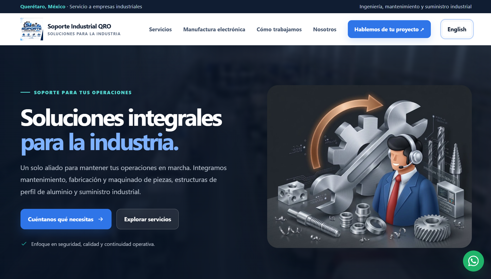

# Soporte Industrial QRO

Sitio web corporativo de **Soporte Industrial QRO**, empresa enfocada en soluciones de ingeniería, mantenimiento, fabricación, maquinados y suministro para el sector industrial en Querétaro, México.

El proyecto fue desarrollado con un enfoque en una interfaz **limpia, moderna, responsive y funcional**, buscando presentar de forma clara los servicios de la empresa y facilitar el contacto directo con clientes mediante WhatsApp y correo electrónico.

---

## Vista previa



---

## Sobre el proyecto

El sitio web presenta los principales servicios y capacidades de **Soporte Industrial QRO**, incluyendo soluciones orientadas al mantenimiento y continuidad de operaciones industriales.

Entre sus principales objetivos se encuentran:

- Presentar los servicios de la empresa de forma clara y profesional.
- Facilitar el contacto con clientes potenciales.
- Mostrar soluciones relacionadas con manufactura e industria.
- Ofrecer una experiencia adaptable a computadoras, tablets y teléfonos.
- Permitir la navegación del sitio tanto en **español como en inglés**.
- Mantener una estructura de código organizada y sencilla de modificar.

---

## Servicios

El sitio presenta diferentes áreas de servicio, entre ellas:

- Mantenimiento de maquinaria.
- Maquinados y fabricación de piezas.
- Estructuras de perfil de aluminio.
- Movimiento y alineación de equipos.
- Suministro industrial.
- Soporte a líneas de producción.
- Soluciones para manufactura electrónica.
- Fabricación de fixtures, soportes y componentes.
- Apoyo técnico para necesidades específicas de planta.

---

## Características

- Diseño responsive.
- Español como idioma predeterminado.
- Traducción del sitio al inglés.
- Navegación mediante secciones.
- Menú adaptable para dispositivos móviles.
- Hero section con video industrial de fondo.
- Elementos visuales e identidad corporativa.
- Formulario para preparar mensajes de WhatsApp.
- Contactos directos mediante WhatsApp.
- Enlace directo mediante correo electrónico.
- Botón flotante de WhatsApp.
- Animaciones y transiciones sutiles.
- Soporte para `prefers-reduced-motion`.
- Código HTML, CSS y JavaScript separado.
- Variables CSS centralizadas mediante `:root`.

---

## Tecnologías utilizadas

El proyecto fue desarrollado principalmente con:

- **HTML5**
- **CSS3**
- **JavaScript**
- **Font Awesome**
- **Google Fonts**

No se utiliza ningún framework de JavaScript.

La intención es mantener el sitio ligero, comprensible y fácil de mantener.

---

## Estructura del proyecto

```text
Soporte_Industrial_QRO_Web/
│
├── LICENSE
├── README.md
│
├── assets/
│   ├── images/
│   │   ├── home.png
│   │   ├── icon.png
│   │   ├── img.png
│   │   └── info.png
│   │
│   └── videos/
│       └── video_example.mp4
│
├── css/
│   └── styles.css
│
├── html/
│   └── index.html
│
└── js/
    └── script.js
```

---

## Organización del código

### HTML

El archivo principal se encuentra en:

```text
html/index.html
```

Contiene la estructura general del sitio y está dividido mediante comentarios para identificar fácilmente las diferentes secciones.

Ejemplo:

```html
<!-- Header / Navigation -->

<!-- Hero Section -->

<!-- Services Section -->

<!-- Contact Section -->

<!-- Footer Section -->
```

---

### CSS

Los estilos se encuentran en:

```text
css/styles.css
```

Las principales opciones de personalización se encuentran dentro de `:root`.

```css
:root {
  /* Colors */

  /* Font Sizes */

  /* Font Weights */

  /* Border Radius */

  /* Site Width */

  /* Scroll Offset */
}
```

Esto permite modificar de manera centralizada aspectos como:

- Colores.
- Tamaños de fuente.
- Bordes.
- Espaciados.
- Ancho máximo.
- Comportamiento de navegación.

El archivo también contiene configuraciones responsive específicas para diferentes tamaños de pantalla.

---

### JavaScript

La lógica del sitio se encuentra en:

```text
js/script.js
```

JavaScript se utiliza para funcionalidades como:

- Menú móvil.
- Cambio de idioma.
- Navegación.
- Formulario de contacto.
- Generación del mensaje de WhatsApp.
- Interacciones de la interfaz.
- Accesibilidad.

---

## Sistema de idiomas

El idioma principal del sitio es **español**.

El usuario puede cambiar el contenido a inglés mediante el botón de idioma ubicado en la navegación.

Las traducciones son gestionadas mediante JavaScript utilizando atributos como:

```html
data-i18n="example"
```

Esto permite mantener ambos idiomas sin crear versiones HTML independientes del sitio.

---

## Contacto mediante WhatsApp

El formulario de contacto no envía información automáticamente a ningún servidor.

En su lugar:

1. El usuario completa los datos.
2. JavaScript prepara el mensaje.
3. Se abre WhatsApp.
4. El usuario puede revisar el mensaje.
5. El usuario decide si desea enviarlo.

Esto permite mantener una implementación sencilla sin necesidad de un backend para el formulario.

---

## Ejecutar el proyecto localmente

Puedes clonar el repositorio:

```bash
git clone https://github.com/r-afikiii/Soporte-Industrial-QRO-Web.git
```

Entra al proyecto:

```bash
cd Soporte_Industrial_QRO_Web
```

Después puedes iniciar un servidor local con Python:

```bash
python3 -m http.server 8000
```

Y abrir:

```text
http://localhost:8000/html/
```

También puedes utilizar extensiones como **Live Server** en Visual Studio Code.

---

## Responsive Design

El sitio está diseñado para adaptarse a diferentes dispositivos:

- Monitores.
- Laptops.
- Tablets.
- Smartphones.

Los principales cambios responsive se administran mediante `@media queries` dentro de:

```text
css/styles.css
```

---

## Recursos

Los elementos gráficos utilizados por el sitio se encuentran dentro de:

```text
assets/images/
```

Los videos utilizados como elementos visuales se encuentran dentro de:

```text
assets/videos/
```

El favicon y logotipo principal utilizan:

```text
assets/images/icon.png
```

---

## Estado del proyecto

El proyecto se encuentra en desarrollo y puede recibir mejoras relacionadas con:

- Optimización de rendimiento.
- Accesibilidad.
- SEO.
- Animaciones.
- Contenido empresarial.
- Nuevas secciones.
- Optimización de imágenes y video.
- Integración con servicios externos.

---

## Contacto

**Soporte Industrial QRO**

Querétaro, México

Correo:

```text
sigro.bm@gmail.com
```

---

## Licencia

Este proyecto utiliza una **licencia propietaria**.

El código fuente, diseño, contenido, logotipos, imágenes, videos y demás recursos pertenecientes a **Soporte Industrial QRO** no pueden ser reutilizados, redistribuidos o comercializados sin autorización previa.

Consulta el archivo [`LICENSE`](LICENSE) para obtener más información.

---

© 2026 Soporte Industrial QRO. Todos los derechos reservados.
